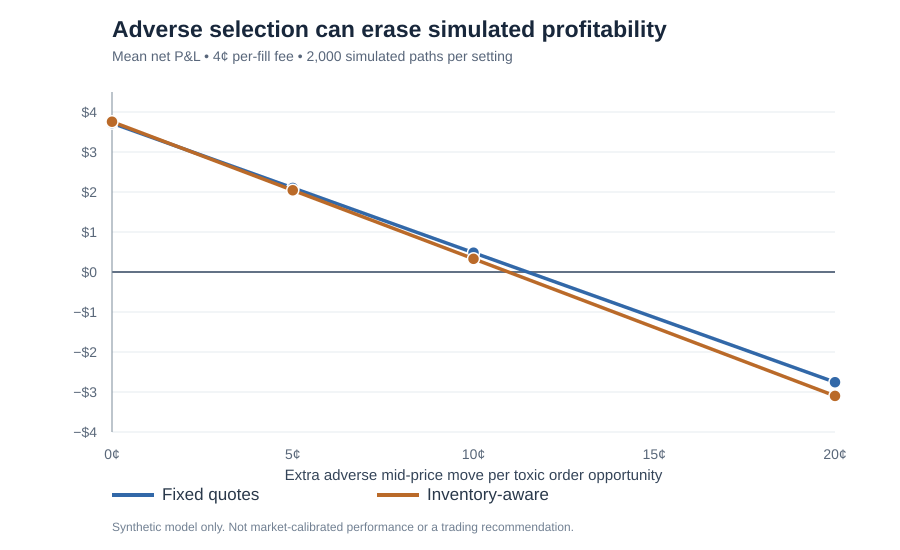

# Experiment 3 — Transaction fees and adverse selection (synthetic)

**Status:** Reproducible toy-model experiment, 23 November 2026. Not historical market data, empirical market calibration, a live strategy, or investment advice.

## Research question

Does inventory-sensitive quoting retain its apparent profitability advantage after allowing for per-execution fees and price moves associated with informed customer order flow?

## What changed

The original price model used independent, zero-drift Gaussian shocks. In this experiment we introduce a **deliberately simple adverse-selection proxy**, not a realistic limit-order-book model:

1. Each step begins with a mid-price and two random synthetic order-opportunity draws.
2. A low bid-side draw represents a customer trying hard to **sell** to the dealer; a low ask-side draw represents someone trying hard to **buy**.
3. When either draw is below a set **8% toxic-signal threshold**, the **next mid-price change** includes an additional adverse directional component: **down** after a bid-side sell opportunity and **up** after an ask-side buy opportunity.
4. Both quoting policies experience **the same exogenous price tape and customer order-opportunity draws**. Quotes may differ, and therefore their executed trades can differ.
5. Each completed fill is charged the specified fixed fee, deducted from the terminal marked-to-mid P&L.

Importantly, the adverse directional price move can occur **even when the model's market maker doesn't execute**. It is a stand-in for public price discovery following aggressive customer order flow, **not impact caused by our model's own trades**. This relationship is baked into the model, not discovered in real data.

## Experimental parameters

- Mid-price starts at **$100**.
- Spread **20 cents**; inventory limit **±6 shares**; adjusted quote skew **1 cent per share held**.
- Independent Gaussian noise with **15 cents** per-step standard deviation.
- **250 time steps** per simulated path.
- **2,000 paths per parameter combination**; seed **20261121**.
- Execution fee: **0, 4, or 8 cents per filled share**.
- Extra next-step adverse move: **0, 5, 10 or 20 cents** per threshold-crossing order opportunity.
- **12 combinations × 2,000 paired paths = 24,000 synthetic path comparisons**, two policies per path. Reusing the seed means comparisons across settings are dependent, not independent replicates.

All cash P&L figures are in *illustrative USD per simulated path*, not investment returns or predictions of dollars a real dealer would earn.

## Main results — average net P&L ($ per path)

| Extra adverse move | Fee per fill | Fixed quotes | Inventory-adjusted | Difference (adjusted minus fixed) | Approx. 95% Monte Carlo CI on difference |
|---:|---:|---:|---:|---:|---|
| 0¢ | 0¢ | +6.304 | +6.560 | +0.256 | [-0.012, +0.524] |
| 0¢ | 4¢ | +3.721 | +3.757 | +0.036 | [-0.231, +0.303] |
| 0¢ | 8¢ | +1.138 | +0.954 | -0.183 | [-0.450, +0.083] |
| 5¢ | 4¢ | +2.102 | +2.043 | -0.058 | [-0.328, +0.212] |
| 10¢ | 4¢ | +0.483 | +0.330 | -0.153 | [-0.430, +0.124] |
| 20¢ | 4¢ | -2.755 | -3.098 | -0.342 | [-0.642, -0.043] |
| 20¢ | 8¢ | -5.338 | -5.901 | -0.562 | [-0.860, -0.265] |

Full 12-scenario dataset: [friction_grid.csv](results/frictions/friction_grid.csv).



## Why this matters

The inventory-aware policy places an average of **70.068 trades per path**, compared with **64.576** for fixed quotes. Its lower inventory exposure helped reduce P&L dispersion in earlier tests, but **more executed trades also means more fee payments**. As the adverse flow penalty increases, the *average* P&L of both policies falls; under severe settings, both lose money on average.

The profit differences at **4¢ fees / 10¢ adverse move** have Monte Carlo confidence intervals that straddle zero. Under **4¢ fees / 20¢ adverse move**, the difference favours fixed quotes in this run. This is an exploratory grid; don't interpret individual unadjusted intervals as conclusive after trying multiple combinations.

One separate observation: inventory-aware quotes often maintain **lower P&L dispersion** even when their average net P&L is worse. Risk management and maximising expected net profit are distinct objectives.

## Reproduce on Windows with Python

From inside the updated repository folder:

```cmd
python -m pip install -r requirements-plot.txt
python -m unittest discover -s tests -v
python friction_study.py --output results\frictions
```

To test a different grid (comma-separated lists):

```cmd
python friction_study.py --trials 3000 --fees 0,2,6 --adverse-moves 0,5,15 --output results\frictions_custom
```

The experiment generates `friction_grid.csv` and, when matplotlib is installed, a PNG chart. The checked-in SVG chart is a static display of the published CSV output.

## Limitations and next tests

- The customer-order draws simultaneously drive fill opportunities and directional price moves: correlation is imposed by construction and not estimated from transaction data.
- No queue priority, latency, variable exchange fees, price impact from the market maker, hedging, changing spread, price jumps or volatility clustering.
- Both strategies share the same artificial order-flow tape. The paired simulation isolates policy changes **within this model**, not in actual trading.
- The current fill rule has unrealistic independence, discrete one-share trades and no inventory funding costs.
- Results depend on chosen fee levels and the 8% toxic-signal threshold. Fees, adverse moves and trade sizes are illustrative rather than calibrated.
- Tested parameter combinations were selected for exploration, not optimised out of sample; confidence intervals quantify **Monte Carlo variation only**, not market-model uncertainty.

A useful next step is to vary the toxic-signal threshold, use conditional order-flow distributions, calibrate against representative limit-order-book data, and evaluate the policies on an out-of-sample dataset before making economic claims.

## Reproducibility and attribution

Source: [friction_study.py](friction_study.py) and [unit tests](tests/test_friction_study.py). Both fixed and adjusted policies share simulated price/order opportunities, and a zero-fee/zero-adverse test reproduces the original model. The project was developed with AI assistance and reviewed with automated checks.
