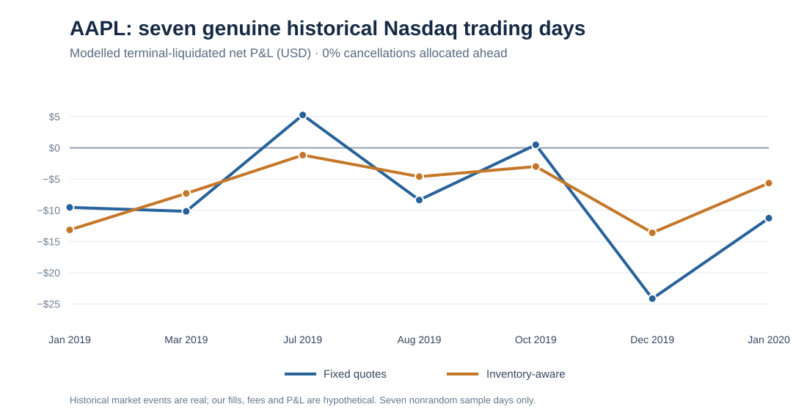

# Experiment 7 — Seven real Nasdaq AAPL trading days (2019–2020)

**Verified:** 24 November 2026. [Full GitHub Actions run — all seven daily jobs and final aggregate successful](https://github.com/rileysanders/market-making-inventory-simulator/actions/runs/45324827552). Source event counts, daily CSVs, aggregate CSV and summary JSON were inspected. **All strategy executions and P&L below are hypothetical**, despite using genuine historical order-book records.

## Executive abstract

We replayed seven **different, actual** Nasdaq TotalView-ITCH 5.0 historical market sessions for AAPL, reconstructed the single-venue displayed book using original limit-order reference IDs, and evaluated two predeclared one-share quoting policies: fixed passive best quotes and inventory-aware one-tick inventory-side retreat. We applied an approximate queue-ahead execution model, fixed order-entry latency, fees, inventory limits and closing-inventory liquidation estimates.

**Main result:** The inventory-aware policy reduced average absolute inventory exposure in all seven dates under the conservative 0% cancellation-ahead assumption. It also recorded a **less negative mean hypothetical daily P&L**, but **both policies lost money on average**, and the inventory-aware policy recorded negative daily P&L on **all seven dates**. The individual daily relative ranking varied.

A real-market profitability edge has **not** been established. This is an educational AI-assisted microstructure study with a deliberately approximate, counterfactual execution model.

## Audited dataset

- **Symbol and venue:** AAPL, Nasdaq exchange displayed TotalView order book; not consolidated NBBO or cross-venue execution.
- **Original source:** [Nasdaq public ITCH](https://emi.nasdaq.com/ITCH/), using original `MMDDYYYY.NASDAQ_ITCH50.gz` files. [Nasdaq ITCH 5.0 specification](https://www.nasdaqtrader.com/content/technicalsupport/specifications/dataproducts/NQTVITCHSpecification_5.0.pdf).
- **Seven different dates:** 2019-01-30, 2019-03-27, 2019-07-30, 2019-08-30, 2019-10-30, 2019-12-30 and 2020-01-30.
- **Nasdaq-wide messages parsed:** **2,369,197,548** across seven original feeds.
- **AAPL regular-session order events reconstructed:** **10,035,344** across seven sessions.
- **Source provenance:** [Download URLs, per-date message and AAPL counts](results/nasdaq_multi_day/source_manifest.csv).
- **Unmodified historical raw files are not redistributed.** Only derived, low-volume metrics are retained in this repository.

Historical exchange observations and the counterfactual simulator's inferred fills are clearly distinguished. A full Nasdaq feed is processed to build the AAPL book; only the AAPL 09:30–16:00 US Eastern regular trading session is evaluated, after premarket orders have been reconstructed.

## Predefined method

All primary comparisons were specified before the newly observed seven-date results were inspected. See the [formal hypotheses and analysis protocol](QUANT_RESEARCH_PROTOCOL.md).

- **Fixed baseline:** join the displayed historical Nasdaq best bid and ask.
- **Inventory-aware:** when long, lower our bid by one 1¢ tick per long share; when short, raise the ask similarly.
- **One-share hypothetical order** on each side, capped at ±6 shares inventory.
- **Order-entry delay:** assumed 10 milliseconds, without a fully calibrated cancel/replace acknowledgement model.
- **Quote refresh:** 2 seconds.
- **Queue model:** assumes all displayed quantity at the quote price was already ahead at the moment we submitted; execution volume at that resting price depletes the estimated queue.
- **Cancellation uncertainty:** three fixed scenarios of 0%, 50% and 100% of historical cancellations attributed to volume ahead.
- **Fees:** illustrative maker/execution cost of 0.3 US cents per hypothetical fill, plus an assumed extra 1 US cent/share taker fee for any final inventory crossed at the displayed opposite best quote.
- **Primary P&L:** terminal-liquidated net P&L when sufficient best-level size is displayed, not gross spread captured or mark-to-midpoint equity.
- **Risk metric:** time-weighted average absolute number of shares held.

**Critical:** We reconstruct the *historical* book from actual exchange order IDs, but the simulated dealer's own order is **not an observed exchange order**. Its queue priority, fill and market impact remain model assumptions.

## Daily results — conservative 0% cancellation ahead

| Historical date | Fixed net P&L | Inventory-aware net P&L | Aware minus fixed | Fixed avg. absolute inventory | Aware avg. absolute inventory |
|---|---:|---:|---:|---:|---:|
| 2019-01-30 | −$9.538 | −$13.141 | −$3.603 | 4.124 | **0.888** |
| 2019-03-27 | −$10.168 | **−$7.302** | +$2.866 | 4.858 | **0.956** |
| 2019-07-30 | **+$5.270** | −$1.161 | −$6.431 | 4.058 | **0.921** |
| 2019-08-30 | −$8.355 | **−$4.608** | +$3.747 | 5.055 | **1.289** |
| 2019-10-30 | **+$0.489** | −$2.989 | −$3.478 | 3.652 | **0.970** |
| 2019-12-30 | −$24.149 | **−$13.604** | +$10.545 | 3.213 | **0.909** |
| 2020-01-30 | −$11.259 | **−$5.641** | +$5.618 | 3.707 | **0.940** |
| **7-day arithmetic mean** | **−$8.244** | **−$6.921** | **+$1.323** | **4.095** | **0.982** |

*USD per hypothetical single-day strategy using one-share orders, including illustrative execution fees and the model's end-of-session position liquidation estimate. These figures are not realised brokerage trades or investment returns.*

Under this reference assumption:
- Inventory-aware quoting beat fixed quotes on **4 of 7** historical days in **less-negative/higher P&L**, and held lower average inventory on **7 of 7** days.
- Inventory-aware quoting lost money on **7 of 7** days; fixed quoting lost money on **5 of 7** days.
- Mean time-weighted absolute inventory was **approximately 76.0% lower** for inventory-aware quoting than the fixed baseline.
- The **+$1.323** mean daily relative P&L is a *descriptive difference*, not a statistically established profit improvement.

## Execution-assumption robustness — all seven dates

| Queue cancellations assumed ahead | Fixed mean terminal net P&L | Aware mean terminal net P&L | Aware-minus-fixed mean | Days aware exceeds fixed |
|---|---:|---:|---:|---:|
| **0%** | −$8.244 | −$6.921 | **+$1.323** | 4 / 7 |
| **50%** | −$18.554 | −$13.588 | **+$4.966** | 5 / 7 |
| **100%** | −$23.789 | −$17.534 | **+$6.254** | 4 / 7 |

The relative advantage under these **assumed** execution models does not establish which assumption is most realistic. More optimistic queue depletion can produce *more* trades at bad times, so average P&L can decrease as assumed fills increase. We report all three scenarios instead of selecting the most profitable.

## Chronologically separated two-date holdout

The last two dates — **2019-12-30 and 2020-01-30** — were labelled as a chronological descriptive holdout. Strategy parameters were fixed before examining their results; no parameter was selected using those dates.

| Queue-cancellation assumption | Fixed mean net P&L | Aware mean net P&L | Difference |
|---|---:|---:|---:|
| 0% | −$17.704 | −$9.623 | **+$8.082** |
| 50% | −$34.707 | −$16.271 | **+$18.436** |
| 100% | −$44.610 | −$16.559 | **+$28.051** |

Inventory-aware quoting lost less in both holdout dates across these three fill assumptions. **Two dates are severely underpowered** and cannot establish out-of-sample positive alpha or statistical significance. The samples were publicly chosen by Nasdaq, not randomly selected for this study.

## What changed relative to the 2012 one-day study?

The 2012 LOBSTER AAPL Level-5 queue study returned **positive hypothetical P&L** under several queue scenarios, whereas the 2019–2020 seven-date study returned **negative mean daily P&L** for both policies. That shows how strongly results can depend on dates and assumptions.

**Do not combine those as one controlled time series**: the trading era, source format, observed order book, and experimental implementation differ. The 2012 single-day [five-stock robustness test](CROSS_ASSET_RESULTS.md) provides cross-sectional insight, not additional independent AAPL dates.

## Reproducibility and tests

**All seven large sample downloads and seven independent replays, plus the aggregate report, completed successfully** in [GitHub Actions run 45324827552](https://github.com/rileysanders/market-making-inventory-simulator/actions/runs/45324827552).

- [Daily 42-strategy/scenario derived results](results/nasdaq_multi_day/daily_policy_results.csv)
- [All-date and two-date holdout summaries (CSV)](results/nasdaq_multi_day/multi_day_table.csv)
- [Machine-readable summary (JSON)](results/nasdaq_multi_day/multi_day_summary.json)
- [Original source manifest](results/nasdaq_multi_day/source_manifest.csv)
- [Event decoder](nasdaq_itch.py) · [Daily replay](nasdaq_day_replay.py) · [Aggregator](nasdaq_multiday_report.py)
- [Scientific protocol](QUANT_RESEARCH_PROTOCOL.md) · [Python 3.10/3.12 tests](.github/workflows/quant-quality.yml)

The full separate daily source artifacts can also be inspected from the [successful workflow run](https://github.com/rileysanders/market-making-inventory-simulator/actions/runs/45324827552).

## What these results cannot establish

The numbers above **must not be described as actual earnings or a profitable live trading backtest**. Limitations include hypothetical queue placement and counterfactual fills, simplified entry/refresh timing and cancellations, unknown order reaction and market impact, uncalibrated fees/rebates, unmodelled hidden liquidity and cross-venue routing, small one-share order size, and only seven nonrandomly selected historical trading dates. Per-event observations are correlated; treating 10 million AAPL events as 10 million independent samples would be pseudo-replication.

**There is no annualised return, Sharpe ratio, confidence interval, claim of market-beating alpha, or validated expected-profit estimate here.** A more defensible extension would use 30–60+ diverse independently dated sessions, reconstructed order-level queue priority and exchange/date-specific fees, realistic cancel/replace latency, and independent reproduction of selected sessions.

## Appropriate résumé description

*Developed an AI-assisted event-driven market-making research framework in Python; reconstructed Nasdaq AAPL order books from over 2.3 billion historical exchange messages across seven trading days, tested inventory-based quoting with modelled queue execution, and documented risk–profit trade-offs with reproducible validation and holdout analyses.*

This describes the **research work**, not guaranteed executable trading profit. Developed with AI assistance for educational/research purposes.
