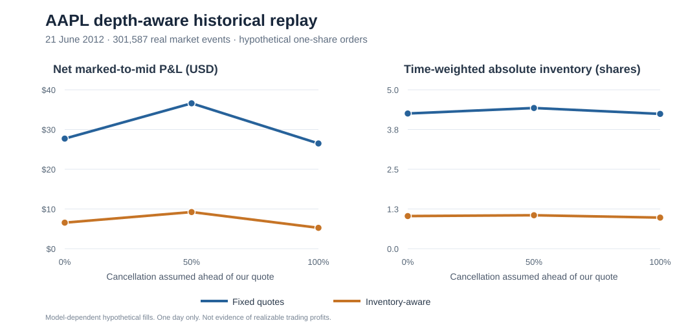

# Experiment 5 — Historical AAPL with depth-aware queue estimates

**Historical run:** 24 November 2026. [Successful GitHub Actions execution](https://github.com/rileysanders/market-making-inventory-simulator/actions/runs/45300262815). **All 31 Python unit tests passed.**

## Hypothesis

The original historical experiment considered a price-touch event sufficient for a hypothetical fill, which can be overly optimistic. Here, we estimate the volume of existing displayed orders ahead of each hypothetical order, account for possible cancellation-ahead allocation and use event-driven fills, with fixed latency and periodic quote replacement.

### Historical sample used

- LOBSTER AAPL **5-level** historical order book, **2012-06-21**, regular Nasdaq session (09:30–16:00 US Eastern)
- **301,587 recorded historical events** (more than Level-1 because the deeper book includes more event types affecting observed depth)
- All dates, prices, observed order events and displayed depth are real sample data
- All our algorithm's resting orders, queue position, executions and P&L remain **hypothetical**

### Prespecified execution settings

- Each posted hypothetical order is **one share**.
- Maximum inventory ±6 shares.
- Quotes refresh every **2 seconds**.
- Assumed **10 millisecond** entry latency.
- At submission the **entire displayed depth** at the target price is assumed to be *ahead* of our hypothetical order.
- Historical visible executions at exactly that price/side consume queue ahead; an assumed fill occurs only once historical execution volume passes the estimated queue position.
- The fraction of historical cancellations/deletions assumed to be ahead is varied: **0%, 50%, 100%**.
- Quotes at price levels no longer visible in the five-level book are cancelled, not assumed to fill.
- Illustrative **0.3 US cents per filled share** in trading fees.
- End-of-session shares are initially valued at midpoint. A separate liquidation sensitivity assumes closing at the recorded best opposing quote, provided displayed depth is sufficient, and adds **1 US cent per share of hypothetical exit fee**.
- No queue-identity reconstruction, realistic cancel acknowledgements, market impact or cross-venue execution is claimed.

These are research assumptions, **not parameters estimated from 2012 exchange execution records**.

## Verified single-day results

| Cancellation-ahead assumption | Strategy | Assumed fills | Net P&L (marked to mid) | Net P&L (terminal liquidation estimate) | Average absolute inventory | Maximum marked drawdown |
|---|---|---:|---:|---:|---:|---:|
| **0%** (conservative) | Fixed | 202 | **+$27.714** | **+$27.264** | 4.254 | $18.376 |
| 0% | Inventory-aware | 164 | +$6.558 | +$6.258 | **1.027** | **$4.338** |
| **50%** | Fixed | 279 | **+$36.598** | **+$36.223** | 4.427 | $18.421 |
| 50% | Inventory-aware | 229 | +$9.228 | +$9.153 | **1.053** | **$3.257** |
| **100%** (optimistic) | Fixed | 316 | **+$26.492** | **+$26.192** | 4.242 | $17.469 |
| 100% | Inventory-aware | 258 | +$5.256 | +$5.256 | **0.979** | **$4.712** |

[Download verified CSV](results/queue_replay/queue_sensitivity.csv) and [run metadata](results/queue_replay/run_info.json). The raw AAPL vendor data was downloaded and processed by the GitHub Actions job, not redistributed in the repository.



### Main finding

The **ranking for average hypothetical net P&L changes** relative to the original touch-fill AAPL replay. Under all three queue-cancellation assumptions, **fixed quoting earns more marked-to-mid and liquidation-estimated net P&L** than the inventory-aware policy. Yet inventory-aware quoting consistently holds much less inventory and experiences lower max marked drawdowns.

At the conservative 0%-cancellation-ahead setting, inventory-aware quoting reduces time-weighted absolute inventory from **4.254 to 1.027 shares** (around **76% lower**) and the largest marked drawdown from **$18.376 to $4.338**, while giving up **$21.156** in net marked-to-mid P&L.

This is a **risk–return tradeoff within an assumed historical replay**, not evidence that an exchange would have matched those orders.

### Why this differs from Experiment 4

Experiment 4 used AAPL **Level 1**, assumed a fill at a recorded trade touching the quoted price, and refreshed quotes using a different mechanism. It reported both policies losing money under those optimistic touch-fill rules.

Experiment 5 uses **Level 5**, adds queue-depth-based arrival, 10ms order-entry latency and 2-second requoting. It reports both hypothetical policies with positive P&L under the tested queue assumptions, but with fixed quotes yielding higher net P&L.

**These experiments are not an apples-to-apples isolated test of one changed variable.** The depth, fill assumptions, quote cadence and policy details differ. This change in ranking is evidence of substantial **model sensitivity**, not proof that either model is more accurate without execution calibration.

### Interpretation and limitations

Positive hypothetical profits are **not** a demonstrated market-making edge. The model still assumes that our one-share order joins the displayed historical queue and eventually fills under a simplified volume-depletion rule; it does not know actual order priority, hidden orders or the feedback an inserted order would have created.

The historical sample spans **one trading day**. No valid annualised return or statistically reliable out-of-sample mean P&L can be inferred. The cancellation fractions are stress-test assumptions, not identified fractions from order IDs. A 1-cent exit fee is illustrative, not an exchange-specific fee schedule.

The program measures session-level maximum drawdown relative to marked equity but does **not** measure live capital usage, adverse-selection markouts specific to hypothetical fills, overnight inventory liquidation or fully realistic slippage.

## How to reproduce

```cmd
python -m unittest discover -s tests -v
python queue_replay.py --download --output results\queue_replay
```

We are **not** repeating the free AAPL 2012-06-21 day under different filenames and describing it as multiple independent days.

## Multi-day extension: code exists, data not yet purchased

[See the predeclared multi-day chronological design](ADVANCED_QUEUE_STUDY.md) and [data procurement guide](MULTI_DAY_DATA_GUIDE.md).

The new `multi_day_research.py` accepts at least **12 unique historical AAPL Level-5 ZIP dates**, selects the inventory skew *using validation days only*, and compares a locked policy against fixed quotes across untouched holdout days and six prespecified execution scenarios. More credibly, we should obtain **30–60 days** and test under distinct conditions.

**No multi-day AAPL results have been run or claimed** because additional licensed historical dates are not yet available. No historical data purchase, brokerage transaction or financial risk has been undertaken.

Developed with AI assistance. This is an educational experiment, not a production market-making system.
