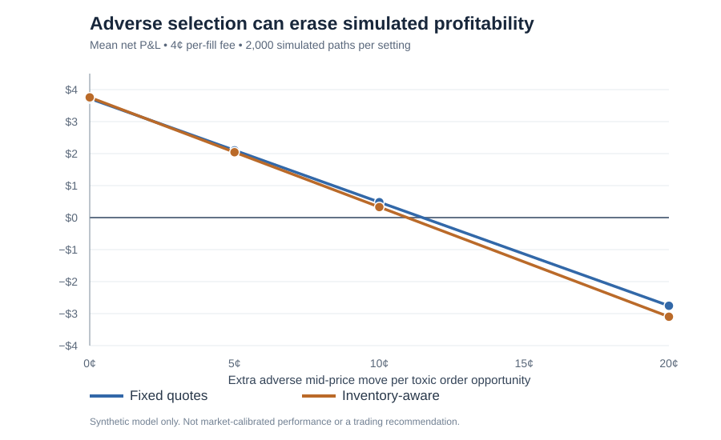
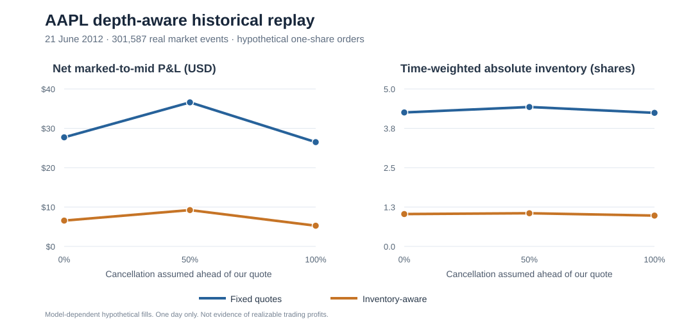
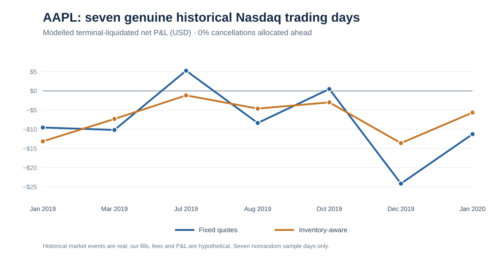

# Market-Making Inventory Simulator

**Python · Monte Carlo simulation · Limit-order-book reconstruction · Market microstructure · Execution risk**

An **AI-assisted quantitative-finance research project** investigating a deceptively simple question:

> **Does changing a market maker's bid and ask prices according to its inventory reduce risk—and does it actually improve profitability once execution conditions and trading costs matter?**

The project began with a small synthetic trading simulator. We gradually added parameter sensitivity, fees and adverse selection, real historical market activity, queue-position estimates, **five-stock comparisons**, and finally **seven genuinely different Nasdaq AAPL trading days** reconstructed from raw order-by-order exchange messages.

**Overall finding:** Inventory-aware pricing often reduced inventory exposure and adverse outcomes *within the models*, but **did not reliably produce positive profit**. In the seven-day historical AAPL study, both strategies had **negative average hypothetical net P&L**, even though inventory awareness cut mean absolute inventory by approximately **76%** under the conservative execution assumption.

> **Evidence boundary:** Real market events and historical orders are observed; our market maker's quotes, queue position, executions, fees and P&L are **hypothetical**. This is an educational research framework—not live trading, an independently validated executable backtest, or evidence of a profitable trading edge. No real money was traded.

[](https://github.com/rileysanders/market-making-inventory-simulator/actions/workflows/quant-quality.yml)

## Start here

- **[Seven-day AAPL research report](NASDAQ_MULTI_DAY_RESULTS.md)** — the most complete historical-data study
- **[Formal research protocol](QUANT_RESEARCH_PROTOCOL.md)** — hypotheses, assumptions, evidence standards and limitations
- **[All seven days of historical results (CSV)](results/nasdaq_multi_day/daily_policy_results.csv)** · **[Summary (CSV)](results/nasdaq_multi_day/multi_day_table.csv)** · **[Source provenance](results/nasdaq_multi_day/source_manifest.csv)**
- **[Successfully completed seven-day GitHub Actions run](https://github.com/rileysanders/market-making-inventory-simulator/actions/runs/45324827552)** — all seven date-specific jobs and the aggregate report passed

## The idea: two competing market makers

Suppose a stock's midpoint is **$100**, and a market maker posts a **$99.90 bid** and **$100.10 ask**. It hopes to earn part of the bid–ask spread by buying and selling, but holding too many shares exposes it to price movements.

- **Fixed quoting:** continually quote around the current midpoint/best prices, without deliberately adjusting for existing inventory.
- **Inventory-aware quoting:** adjust quoting according to current inventory. If the market maker is long shares, it becomes less willing to acquire more; if short, it becomes less willing to sell more.

Both policies face a **six-share inventory limit** in the core experiments. The exact quote adjustment differs across the *synthetic* and *historical* engines: the synthetic model shifts both quotes, whereas the later historical model retreats the inventory-increasing side. The results should therefore be read as a **progression of research designs**, not one controlled experiment with every other variable held fixed.

### Research progression — all seven completed studies

| # | Experiment | What we tested | Main result | Details |
|---|---|---|---|---|
| **1** | **Synthetic baseline** | 2,000 paired Monte Carlo trading sessions | Inventory-aware mean P&L **$6.665 vs $6.406**; lower P&L variability | [Results](results/summary.csv) · [Code](simulate.py) |
| **2** | **Volatility × inventory skew** | 12 parameter combinations, 2,000 simulations each | Downside protection persisted; average profit improvement became statistically uncertain at higher volatility | [Report](RESEARCH_NOTES.md) · [Code](sensitivity.py) |
| **3** | **Transaction costs and adverse selection** | Fees and deliberately adverse synthetic price moves | Trading costs could **erase or reverse** the apparent profit advantage | [Report](FRICTION_STUDY.md) · [Code](friction_study.py) |
| **4** | **Historical AAPL, Level 1** | Actual 2012 Nasdaq order events; touch vs trade-through fills | Optimistic-fill replay lost money; stricter rule produced **zero fills** | [Report](AAPL_HISTORICAL_STUDY.md) · [Code](aapl_replay.py) |
| **5** | **Historical AAPL, Level 5** | Displayed depth, estimated queue-ahead volume, latency and cancellations | Fixed quotes had higher hypothetical P&L; inventory-aware quotes held far less inventory | [Report](QUEUE_RESULTS.md) · [Code](queue_replay.py) |
| **6** | **Cross-stock robustness** | AAPL, AMZN, GOOG, INTC and MSFT on the **same** 2012 date | Inventory-aware reduced average inventory for all five; improved hypothetical P&L for only one | [Report](CROSS_ASSET_RESULTS.md) · [Code](cross_stock_replay.py) |
| **7** | **Seven distinct real AAPL days** | Raw Nasdaq ITCH order-ID reconstruction, 2019–2020; 42 strategy/scenario results | Inventory-aware reduced inventory ~76%; **both policies lost money on average** | **[Final report](NASDAQ_MULTI_DAY_RESULTS.md)** · [Data](results/nasdaq_multi_day/) |

**Experiments 1–3 use entirely synthetic market activity.** Experiments 4–7 use **actual historical exchange/order-book events**, but strategy executions remain counterfactual. Experiment 6 is **five stocks on one date**, not five independent days.

---

## Part I — Building and challenging the synthetic model

### Experiment 1: baseline Monte Carlo comparison

**Question:** Is accounting for inventory better than quoting a fixed spread in a simple simulated market?

We generated **2,000 paired sessions**, with **250 time steps** per session, random price changes and customer-order opportunities. Both strategies were evaluated against the *same generated market path* per trial. The initial midpoint was $100; the spread was 20 cents and inventory adjustment was 1 cent/share.

| Per simulated trading session | Fixed quotes | Inventory-aware |
|---|---:|---:|
| **Mean terminal P&L** | $6.406 | **$6.665** |
| **P&L standard deviation** | $2.767 | **$1.533** |
| **5th-percentile P&L** | $1.685 | **$4.230** |
| **Mean maximum absolute inventory** | 5.704 | **4.066** |

**Interpretation:** Inventory awareness reduced exposure and P&L volatility while slightly raising mean P&L *under the original toy assumptions*. That is not a result about actual markets.

**Reproduce:** `python simulate.py --output results/original` · [Raw results](results/summary.csv)

### Experiment 2: volatility and inventory-skew sensitivity

**Question:** Does the original result survive different market conditions?

We tested **three synthetic price-volatility settings (5¢, 15¢, 30¢)** crossed with **four quote-skew settings (0, 0.5¢, 1¢, 1.5¢ per inventory unit)**, running 2,000 paired trials at each setting.

At **15¢ volatility and 1¢ skew**, the paired average P&L difference was **+$0.256 per trial**, but its approximate **95% Monte Carlo confidence interval was [−$0.012, +$0.524]**. Thus, a positive mean difference was *not* firmly established at that setting, even though the inventory-aware strategy consistently had lower simulated P&L dispersion.


**Interpretation:** **Risk reduction was more robust than the apparent average-profit advantage.** The confidence intervals measure uncertainty *inside the synthetic model*, not model accuracy or actual-market performance.

**Report:** [Research notes](RESEARCH_NOTES.md) · [Full parameter results](results/sensitivity/sensitivity.csv)

### Experiment 3: fees and adverse selection

**Question:** Can the apparent profit advantage survive realistic *types* of friction?

We introduced **0¢/4¢/8¢ per-share fees**, together with **0¢/5¢/10¢/20¢** deliberately adverse synthetic price moves associated with selected customer orders (a constructed 8% order-flow signal).

At **4¢ fees and a 20¢ adverse move**, average simulated *net* P&L was:

| Policy | Mean net P&L | 5th-percentile net P&L |
|---|---:|---:|
| Fixed | **−$2.755** | −$18.652 |
| Inventory-aware | −$3.098 | **−$11.279** |



**Interpretation:** Inventory awareness reduced the severity of downside outcomes but could **lose more money on average** once trading costs and adverse-selection proxies were included. The order-flow/price relationship was **programmed**, not discovered from market data.

**Report:** [Fees and adverse-selection study](FRICTION_STUDY.md) · [Full sensitivity grid](results/frictions/friction_grid.csv)

---

## Part II — Moving from synthetic data to real exchange records

### Experiment 4: historical AAPL, simplified execution assumptions

**Question:** What changes when we use observed Nasdaq order events instead of randomly simulated price/order activity?

We replayed **118,497 AAPL Level-1 events** from the **21 June 2012 LOBSTER sample**. The project also measured observed historical passive-trade price *markouts* at 1 and 5 seconds.

- **Observed executions:** volume-weighted passive execution-price markouts of **+$0.003027/share at 1 second** and **−$0.005443/share at 5 seconds**. These describe *historical market trades*, not our strategy.
- **Optimistic same-price touch fills:** hypothetical net P&L of **−$74.604 (fixed)** versus **−$41.992 (inventory-aware)**.
- **Stricter trade-through fills:** **zero assumed executions** for both policies, showing how strongly the result depends on whether our order is assumed to fill.

**Interpretation:** Replacing synthetic price paths with real data is insufficient if the execution assumption itself is unrealistic.

**Report:** [AAPL Level-1 historical study](AAPL_HISTORICAL_STUDY.md) · [Derived observations](results/aapl/)

### Experiment 5: five-level depth and estimated queue position

**Question:** Can we make hypothetical fills more conservative by modelling the displayed shares already queued ahead of us?

We replayed **301,587 AAPL Level-5 market events**, again from **21 June 2012**. An assumed one-share order joins *behind* the displayed size at its price; recorded executions must use up the modelled queue-ahead volume before it receives a hypothetical fill. We added an assumed **10 ms order-entry delay**, **2-second quote refresh**, illustrative fees and **0%/50%/100% cancellation-ahead scenarios**.

Under **0% cancellation-ahead allocation**:

| Policy | Hypothetical net P&L, marked to midpoint | Average absolute inventory | Max marked drawdown |
|---|---:|---:|---:|
| Fixed | **+$27.714** | 4.254 shares | $18.376 |
| Inventory-aware | +$6.558 | **1.027 shares** | **$4.338** |



**Interpretation:** The inventory-aware strategy held less inventory and had lower marked drawdown, **but gave up hypothetical profit** in this model. The changed ranking versus Experiment 4 reflects **different models, event coverage, quote rules and fill assumptions**—not proof that the new simulator is accurate.

**Report:** [Queue-model research](QUEUE_RESULTS.md) · [Results](results/queue_replay/queue_sensitivity.csv)

### Experiment 6: five different stocks, one historical day

**Question:** Is the inventory-risk effect specific to Apple?

Using the same **21 June 2012** LOBSTER historical date, we evaluated **AAPL, AMZN, GOOG, INTC and MSFT** under the depth-aware model.


At the conservative 0% queue-cancellation setting, inventory-aware quoting **reduced mean absolute inventory for all five stocks**. It produced higher hypothetical net P&L for **only INTC**, where both strategies nevertheless lost money.

**Interpretation:** Inventory effects varied across instruments. **Five stocks on the same day are not five independent periods**; one-share dollar P&L is also not directly comparable as an investment return across differently priced shares.

**Report:** [Cross-stock findings](CROSS_ASSET_RESULTS.md) · [All 30 scenarios](results/cross_stocks/all_scenarios_summary.csv)

---

## Part III — Seven genuinely different Nasdaq trading days

### Experiment 7: original binary exchange feed and multi-day analysis

**Question:** Do the earlier findings persist over different historical AAPL trading sessions?

We built [a streaming Nasdaq TotalView-ITCH 5.0 decoder](nasdaq_itch.py) that reconstructs AAPL's *historical* displayed order book using exchange order IDs and records for order additions, executions, cancellations, deletions and replacements. [The event-driven market-making replay](nasdaq_day_replay.py) then evaluates the two hypothetical quoting policies.

**Data verified in a completed seven-day GitHub Actions run:**

- **7 separate historical Nasdaq dates:** January, March, July, August, October, December 2019 and January 2020.
- **2,369,197,548 total Nasdaq exchange messages decoded**, of which **10,035,344** are reconstructed **AAPL regular-session order events**.
- **3 queue-cancellation assumptions × 2 quoting policies × 7 real dates = 42 modelled strategy/scenario outcomes**.
- **Last 2 chronological dates** reported separately as a small *descriptive* holdout. We did not tune a strategy using their results.

The original exchange messages are real. Our proposed quotes, simulated queue positions, fills and P&L are **not historically observed executions**.

#### Main seven-day results

**Average hypothetical daily net P&L after estimated final inventory liquidation (USD):**

| Assumed queue cancellations ahead | Fixed | Inventory-aware | Aware minus fixed |
|---|---:|---:|---:|
| **0% — conservative** | −$8.244 | **−$6.921** | +$1.323 |
| 50% | −$18.554 | **−$13.588** | +$4.966 |
| 100% | −$23.789 | **−$17.534** | +$6.254 |

At **0% cancellation-ahead allocation**, the average absolute inventory declined from **4.095 to 0.982 shares** (**~76% lower**). Inventory-aware quoting showed a higher (or less-negative) hypothetical net outcome on **4 of 7 days**, but **lost money on all seven days**.



**What this means:** Under these assumed fills and fees, inventory-aware quoting reduced risk exposure and average losses, **not** that it produced a profitable trading strategy. The dates are nonrandom public samples, and seven sessions are too few to establish a robust expected-return estimate, annualised Sharpe ratio or statistically meaningful out-of-sample edge.

**Full evidence:** **[Seven-day historical research report](NASDAQ_MULTI_DAY_RESULTS.md)** · [42 daily policy rows](results/nasdaq_multi_day/daily_policy_results.csv) · [All-date and holdout table](results/nasdaq_multi_day/multi_day_table.csv) · [Source and event-count manifest](results/nasdaq_multi_day/source_manifest.csv) · [Successful original run](https://github.com/rileysanders/market-making-inventory-simulator/actions/runs/45324827552)

---

## What the whole project found

The results changed as the assumptions became more demanding:

1. **In a simple artificial market**, inventory-aware quotes improved the simulated risk profile and slightly increased mean P&L.
2. **Under volatility, fees and adverse selection**, the risk benefit often persisted, but the profit advantage became uncertain or reversed.
3. **With actual historical market activity**, the reported hypothetical P&L depended heavily on how we modelled execution, queue depth, latency and liquidation.
4. **Across five stocks and seven additional AAPL trading days**, reduced inventory exposure was more consistent than improved profitability; the seven-day AAPL results were **negative on average for both strategies**.

The central research lesson is that **managing inventory risk and earning executable trading profits are different problems**.

## Reproducibility — Windows Command Prompt

Install **Python 3.10+** and open Command Prompt in the extracted project folder. The core simulations and tests use the Python standard library; optional plotting uses [matplotlib](requirements-plot.txt).

```cmd
python -m pip install -r requirements-plot.txt
python -m unittest discover -s tests -v
```

**Experiments 1–3 — synthetic data, no download required:**

```cmd
python simulate.py --output results\original
python sensitivity.py --output results\sensitivity
python friction_study.py --output results\frictions
```

**Experiments 4–6 — free LOBSTER historical sample data:**

```cmd
python aapl_replay.py --download --output results\aapl
python queue_replay.py --download --output results\queue_replay
python cross_stock_replay.py --download --output results\cross_stocks
```

**Experiment 7 — free but very large Nasdaq binary source files:**

The GitHub Actions [seven-day workflow](.github/workflows/nasdaq-seven-days.yml) successfully processed all seven dates and saved small derived outputs. To reproduce locally, [the Windows launcher](run_nasdaq_public_windows.bat) requires explicit confirmation because the source files total **over 30 GB compressed**.

```cmd
python nasdaq_day_replay.py --date 01302019
python nasdaq_multiday_report.py --results-dir results\nasdaq_public
```

The first command processes **one** genuine historical Nasdaq day; the second requires **at least three different completed daily outputs**. Run the seven-day workflow or launcher for the full seven-day result.

An additional [multi-day LOBSTER-ZIP pipeline](multi_day_research.py) is also available but requires **extra licensed LOBSTER dates**; it is **separate from the completed free Nasdaq ITCH seven-day study**. See [historical data procurement notes](MULTI_DAY_DATA_GUIDE.md).

Automated testing: [Python 3.10 and 3.12 continuous integration](.github/workflows/quant-quality.yml). The verified research version has **42 tests passing**. Check the Actions badge for current status after future code changes.

## Limits, research integrity and future work

- **Observed vs hypothetical:** Nasdaq/LOBSTER market data are real; our inserted orders, queue-ahead estimates, fills, fees and P&L are not observed exchange executions.
- **Model dependence:** The synthetic and historical policies, sources, quote mechanics and event coverage differ. Their P&L must **not** be treated as a controlled apples-to-apples backtest across all seven studies.
- **Execution:** Order-priority assumptions, cancellation-ahead allocation, entry/cancel latency, hidden liquidity, venue-specific fee schedules and how the market might react to our own orders are not fully calibrated or independently validated.
- **Inference:** Seven publicly released, nonrandom historical dates are not enough to demonstrate stable expected returns; no reliable annualised return, statistical alpha or investable strategy is claimed.
- **Next research steps:** independently validate reconstructed books and hypothetical queue fills, implement better per-order priority/cancel timing, calibrate historical venue fees, and test **30–60+ additional independent trading days** under an unchanged protocol.
- **Data stewardship:** Exchange/vendor raw files are not redistributed in this repository; reports include source URLs and saved **derived** observations.

This project was developed with **AI assistance**. Code, assumptions, negative results, tests and research limitations are provided transparently for review. **No real-money trades or historical data purchases were made.**
